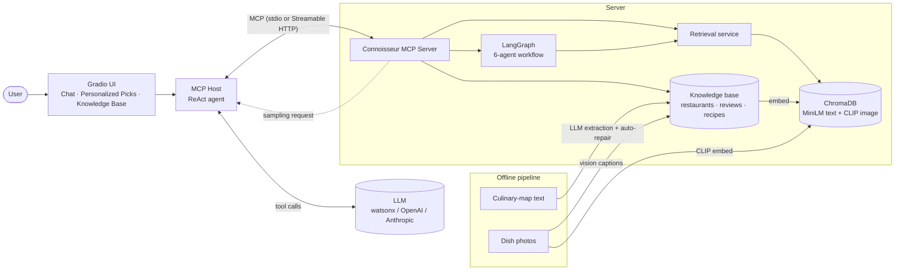
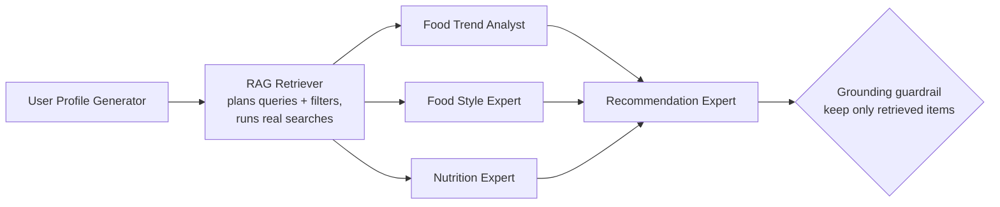

# 🍷 Connoisseur Companion: Multimodal RAG + Multi-Agent Restaurant Recommender over MCP

[](#quick-start)
[](https://modelcontextprotocol.io)
[](https://langchain-ai.github.io/langgraph/)
[](https://www.trychroma.com/)
[](https://gradio.app)
[](#configure-an-llm-provider)
[](LICENSE)

**Connoisseur Companion** is an AI concierge for California's restaurant scene. It turns messy restaurant write-ups, user reviews and dish photos into a structured, searchable knowledge base. A **multimodal retrieval** layer (text + image embeddings) and a team of **six specialised agents** sit on top, and the whole thing is served as a **Model Context Protocol (MCP) server**. That means any MCP-capable host can use it: the bundled Gradio app, Claude Desktop, an IDE, or your own agent.

> Ask *"Find me a moody spot in DTLA"*, *"Tell me about Sakura Garden"* or *"I'm vegan and gluten-free, where should I eat and what should I cook?"*. The agent picks the right tools, retrieves grounded evidence and answers with reasons.

Built as the capstone of the **[IBM RAG and Agentic AI Professional Certificate](https://www.coursera.org/professional-certificates/ibm-rag-and-agentic-ai)** ([capstone course](https://www.coursera.org/learn/rag-and-agentic-ai-capstone-project)). The twelve course labs are consolidated here into one production-structured application.

---

## Table of contents
- [Highlights](#highlights)
- [Architecture](#architecture)
- [MCP interface](#mcp-interface)
- [The multi-agent workflow](#the-multi-agent-workflow)
- [Quick start](#quick-start)
- [Configure an LLM provider](#configure-an-llm-provider)
- [Use it from Claude Desktop or any MCP host](#use-it-from-claude-desktop-or-any-mcp-host)
- [Deployment](#deployment)
- [CLI reference](#cli-reference)
- [Project structure](#project-structure)
- [Testing](#testing)
- [Engineering notes](#engineering-notes)
- [Limitations & roadmap](#limitations--roadmap)
- [Acknowledgements](#acknowledgements)
- [Author & copyright](#author--copyright)

---

## Highlights

| Capability | What it does | Key tech |
|---|---|---|
| **LLM data structuring** | Converts free-text restaurant descriptions into validated JSON using a one-shot prompt, Pydantic validation and a bounded LLM *auto-repair* loop | LangChain, Pydantic, watsonx Granite |
| **Vision captioning** | Describes dish photos (and review photos, grounded in the review text) so images become searchable | Llama-4 Maverick vision / GPT-4o / Claude |
| **Multimodal vector index** | Three ChromaDB collections: restaurants and recipes (MiniLM, 384-d) and dish photos (CLIP, 512-d), all cosine-normalised | ChromaDB, Sentence-Transformers, CLIP |
| **Hybrid retrieval** | Semantic search with metadata filters (budget, rating, neighborhood, cuisine), text → image search, and image → image *"looks like"* search | ChromaDB `where` filters |
| **Cross-modal fusion** | Min-max calibrates MiniLM and CLIP scores and fuses them with tunable weights into a single ranking | NumPy |
| **Multi-agent recommender** | Six agents in a LangGraph graph with a **parallel** analysis phase and a **grounding guardrail** that drops any recommendation that wasn't retrieved | LangGraph |
| **MCP server** | 9 tools, 3 resources, 1 prompt, and **sampling**, over stdio *or* Streamable HTTP, with a `/health` endpoint | FastMCP 3 |
| **MCP host** | ReAct agent that discovers tools at runtime, shows its tool calls live, and fulfils the server's sampling requests | LangChain tool calling, Gradio 6 |
| **Production touches** | Provider-agnostic LLM factory, `.env` config, atomic writes with backups, graceful degradation, Docker / Compose / HF Spaces, 18 tests | pydantic-settings, pytest |

---

## Architecture



| Course module | Where it lives | What changed from the lab prototype |
|---|---|---|
| **1. Structuring multimodal data** (Labs 1–3) | `ingestion/extractor.py`, `ingestion/captioner.py`, `knowledge_base.py`, `connoisseur kb` | One canonical schema; atomic writes with `.bak` backups; resumable bulk ingestion; credentials from env, not hard-coded |
| **2. Multimodal retrieval** (Labs 4–6) | `retrieval/` | Richer documents (vibes, dish, description); a recipe text collection; real cosine space; images keyed by recipe ID; keyword fallback when no index exists |
| **3. Multi-agent system** (Labs 7–9) | `agents/` | A real LangGraph `StateGraph` (the lab used a thread pool) running against **real retrieval** instead of simulated/mock data, plus a grounding guardrail |
| **4. Model Context Protocol** (Labs 10–12) | `mcp_server.py`, `mcp_client.py`, `mcp_connection.py`, `host/` | 6 new tools, resources, a prompt, sampling actually used by a tool, HTTP transport, health check, warm-up, live tool trace in the UI |

Screenshots from each course milestone are in [`docs/images/milestones/`](docs/images/milestones/).

---

## MCP interface

| Type | Name | Purpose |
|---|---|---|
| 🔧 tool | `get_restaurant_info` | Partial-name lookup (`"Iron"` → *Iron & Embers*) |
| 🔧 tool | `recommend_by_vibe` | Vibe tags + raw culinary-map excerpts (`"moody"`, `"zen"`) |
| 🔧 tool | `get_review` | Full review, including the AI caption of the reviewer's photo |
| 🔧 tool | `search_restaurants` | Semantic search + filters: `neighborhood`, `cuisine`, `max_price`, `min_rating` |
| 🔧 tool | `search_recipes` | Semantic recipe search (ingredients + photo captions) |
| 🔧 tool | `multimodal_search` | Fused restaurant-text + dish-photo ranking with tunable weights |
| 🔧 tool | `find_similar_dishes` | Image → image similarity using stored CLIP vectors |
| 🔧 tool | `personalized_recommendations` | Runs the full six-agent workflow |
| 🔧 tool | `summarize_reviews` | Uses **MCP sampling**: the *client's* LLM writes the summary, so the server needs no model credentials for it |
| 📄 resource | `culinary-map://california` | Raw culinary-map text |
| 📄 resource | `knowledge-base://restaurants` | All structured restaurant records |
| 📄 resource | `knowledge-base://status` | Knowledge-base size and index counts |
| 💬 prompt | `plan_a_night_out` | Reusable prompt template (occasion, neighborhood, budget) |

The client also declares **roots** (the project directory), and the HTTP server exposes `GET /health`.

> **Design choice:** write operations (add, edit, delete restaurants) are deliberately **not** MCP tools. They live in the admin UI tab and the CLI, behind a confirmation step, so a prompt-injected or confused chat agent can never modify data.

---

## The multi-agent workflow



- **Phase 1–2 (sequential):** build a profile from free text, then let the retriever agent plan 2–3 searches with filters. If the filters are too strict, they are relaxed automatically.
- **Phase 3 (parallel):** the trend, style and nutrition experts run concurrently (a LangGraph fan-out/fan-in; errors merge through a reducer).
- **Phase 4 (synthesis):** the recommender may only pick from retrieved candidates. Anything else is discarded, and survivors are enriched with their real facts (rating, price, neighborhood).
- Every node degrades gracefully: a malformed LLM reply is recorded in `errors` instead of crashing the run.

---

## Quick start

**Prerequisites:** Python 3.11–3.13, ~3 GB free disk (models + images), and credentials for one LLM provider ([see below](#configure-an-llm-provider)). Retrieval, search and the MCP checks work **without** an LLM key; only chat, agents and ingestion need one.

```bash
git clone https://github.com/gomzee1024/RestaurantRecommendationSystem.git
cd RestaurantRecommendationSystem

python -m venv .venv
source .venv/bin/activate            # Windows: .venv\Scripts\activate

# (optional) CPU-only torch is much smaller than the default CUDA build
pip install torch --index-url https://download.pytorch.org/whl/cpu
pip install -r requirements.txt
pip install -e .                     # installs the `connoisseur` command

cp .env.example .env                 # Windows: copy .env.example .env  - then add your keys
```

```bash
connoisseur download-data --with-images   # datasets + 109 dish photos (~215 MB, one-off)
connoisseur build-index                   # embeddings -> ChromaDB (downloads MiniLM + CLIP on first run)
connoisseur check                         # end-to-end MCP verification (no LLM key needed)
connoisseur ui                            # http://127.0.0.1:7860
```

Optional, with an LLM key:

```bash
connoisseur ingest            # grow the knowledge base from 20 seed restaurants to ~210 extracted by the LLM
connoisseur caption-recipes   # add vision-LLM captions to recipes
connoisseur build-index       # re-index so search sees the new data
connoisseur recommend "I'm vegan, love spicy food and have a mid-range budget"
```

> The first MCP server start loads the embedding models (~10–30 s depending on the machine). After that, queries return in milliseconds and the desktop app reuses one warm server process.

---

## Configure an LLM provider

Set `LLM_PROVIDER` in `.env` and provide that provider's credentials:

| `LLM_PROVIDER` | Required variables | Default chat model | Default vision model |
|---|---|---|---|
| `watsonx` *(default)* | `WATSONX_APIKEY`, `WATSONX_PROJECT_ID`, `WATSONX_URL` | `ibm/granite-4-h-small` | `meta-llama/llama-4-maverick-17b-128e-instruct-fp8` |
| `openai` | `OPENAI_API_KEY` | `gpt-4o-mini` | `gpt-4o-mini` |
| `anthropic` | `ANTHROPIC_API_KEY` | `claude-opus-5-5` | `claude-opus-5-5` |

Override models with `LLM_MODEL` / `VISION_MODEL` (e.g. `LLM_MODEL=claude-sonnet-5-5` for a cheaper Claude). Claude models choose their own sampling, so `LLM_TEMPERATURE` applies to watsonx and OpenAI only. For watsonx, create a project at [cloud.ibm.com](https://cloud.ibm.com) → *watsonx.ai*, associate a Runtime service, then copy the project ID and an IBM Cloud API key.

---

## Use it from Claude Desktop or any MCP host

The server is a standard MCP server, so you can plug it into any host. For Claude Desktop, add this to `claude_desktop_config.json` (use your own absolute paths):

```json
{
  "mcpServers": {
    "connoisseur": {
      "command": "/absolute/path/to/RestaurantRecommendationSystem/.venv/bin/python",
      "args": ["-m", "connoisseur.mcp_server"]
    }
  }
}
```

On Windows the command is `...\\.venv\\Scripts\\python.exe`. The server reads `.env` from the project folder, and `summarize_reviews` uses the host's own model through sampling.

---

## Deployment

### Docker (single container)
```bash
docker build -t connoisseur-companion .        # bakes data, models and the index into the image
docker run -p 7860:7860 --env-file .env connoisseur-companion
```
Add `--build-arg WITH_IMAGES=false` for a smaller image without the CLIP photo index (multimodal and *similar dishes* search are then disabled).

### Docker Compose (MCP server as its own service)
```bash
docker compose up --build    # UI on :7860, MCP server on :8000 (/mcp, /health)
```
The UI container talks to the MCP server over Streamable HTTP (`MCP_SERVER_URL=http://mcp-server:8000/mcp`). The same server can also serve other MCP clients on port 8000. Data lives in the `connoisseur-data` volume.

### Hugging Face Spaces / any PaaS
`app.py` bootstraps the data and index on first start and launches the UI. On Hugging Face, create a **Gradio** Space, push this repo, add your LLM keys as *Secrets*, and put this front-matter at the top of the Space's README:
```yaml
---
title: Connoisseur Companion
sdk: gradio
app_file: app.py
---
```
For Render, Railway, Fly.io or Cloud Run, deploy the Dockerfile, set the env vars from `.env.example`, and expose port 7860 (or 8000 when running `connoisseur serve --transport http`).

---

## CLI reference

| Command | Description |
|---|---|
| `connoisseur download-data [--with-images] [--force]` | Fetch datasets into `data/` and seed working files |
| `connoisseur ingest [--limit N]` | LLM-extract restaurants from the culinary map (resumable, skips known ones) |
| `connoisseur caption-recipes [--limit N]` | Vision-LLM captions for dish photos |
| `connoisseur build-index [--no-images]` | (Re)build the ChromaDB collections |
| `connoisseur status` | Knowledge-base and index summary |
| `connoisseur kb` | Interactive manager: browse, view, add (LLM), edit, delete |
| `connoisseur recommend "<about you>" [--top-n 3]` | Run the multi-agent workflow in the terminal |
| `connoisseur serve [--transport stdio\|http] [--port 8000]` | Run the MCP server |
| `connoisseur check [--sampling]` | Verify discovery + every tool over the real protocol |
| `connoisseur ui [--share] [--port 7860]` | Launch the Gradio app (`--share` = public link) |

---

## Project structure

```
RestaurantRecommendationSystem/
├── src/connoisseur/
│   ├── config.py               # env-driven settings (.env), logging
│   ├── llm.py                  # provider-agnostic chat/vision model factory, JSON parsing
│   ├── schemas.py              # Pydantic models: Restaurant, Review, Recipe
│   ├── knowledge_base.py       # JSON repository: lookups, CRUD, atomic writes + backups
│   ├── ingestion/
│   │   ├── download.py         # dataset fetcher (retries) + seeding
│   │   ├── extractor.py        # text -> validated JSON with LLM auto-repair
│   │   └── captioner.py        # vision-LLM captions (files or URLs, review-grounded)
│   ├── retrieval/
│   │   ├── embeddings.py       # MiniLM + CLIP, lazy-loaded, L2-normalised
│   │   ├── vector_store.py     # ChromaDB collections, filtered + image search, index build
│   │   ├── fusion.py           # min-max calibration + weighted fusion
│   │   └── service.py          # one retrieval façade with keyword fallback
│   ├── agents/
│   │   ├── personas.py         # six agent roles, goals, backstories
│   │   └── workflow.py         # LangGraph workflow + grounding guardrail + formatter
│   ├── mcp_server.py           # MCP tools, resources, prompt, sampling, /health
│   ├── mcp_connection.py       # client factory: stdio/HTTP transport, roots, sampling handler
│   ├── mcp_client.py           # end-to-end protocol checks (`connoisseur check`)
│   ├── host/
│   │   ├── agent.py            # MCP host: ReAct loop with runtime tool discovery
│   │   └── ui.py               # Gradio app (chat, personalized picks, KB admin, about)
│   └── cli.py                  # `connoisseur` command
├── tests/                      # 18 tests: KB, retrieval/fusion, extractor, LangGraph, MCP protocol
├── docs/images/milestones/     # screenshots from each course lab
├── data/                       # generated (git-ignored): datasets, KB, ChromaDB
├── app.py                      # Hugging Face Spaces entry point
├── Dockerfile · docker-compose.yml
├── pyproject.toml · requirements.txt · .env.example
```

---

## Testing

```bash
pip install -e ".[dev]"
pytest
```

The suite needs **no API keys**. A role-aware fake LLM drives the extraction repair loop and the full LangGraph workflow, including the parallel branches, the grounding guardrail and bad-JSON degradation. The MCP server is exercised over the real protocol with fastmcp's in-memory transport, including a sampling round-trip. For a live end-to-end check against the real index over stdio, run `connoisseur check`.

---

## Engineering notes

Things worth knowing that came up while turning the lab prototypes into an application:

- **Image ↔ recipe mis-alignment fixed.** The lab paired `sorted(image_paths)` with the recipe list by position, but lexicographic order (`recipe1, recipe10, recipe100…`) silently mislabelled most images. Images are now keyed by `recipe{id}.png`.
- **True cosine similarity.** The lab computed `1 − distance` on Chroma's default **L2** space. Collections are now created with `hnsw:space=cosine`, so the score really is cosine similarity before fusion.
- **Windows stdio deadlock.** Lazily importing torch/scipy native DLLs from a worker thread hung the stdio MCP server once its transport thread was blocked reading stdin. Models now load on the main thread *before* serving, which also makes every query fast.
- **Env propagation.** MCP stdio servers don't inherit the parent environment by default, so API keys silently vanish. The host passes the environment explicitly.
- **ChromaDB clients aren't safe to create concurrently.** There is now one shared client per path behind a lock.
- **Grounding over trust.** The final agent's picks are validated against what was actually retrieved, so hallucinated restaurants never reach the user.
- **Graceful degradation.** No vector index → keyword search; no LLM key → clear guidance instead of stack traces; a failing agent → a recorded warning instead of a failed run.

---

## Limitations & roadmap

- The seed knowledge base has the 20 curated restaurants that the MCP labs used. Run `connoisseur ingest` to extract all ~210 from the culinary map.
- The six-agent workflow makes six LLM calls, so expect roughly 20–60 s depending on the provider. Streaming partial results to the UI is a natural next step.
- Restaurant and review records are JSON files, which is ideal for this dataset size. A larger deployment would move them to Postgres or SQLite and run ChromaDB in client/server mode for multi-writer setups.
- Ideas: user accounts with remembered profiles, image upload for "find dishes like this photo", evaluation harness (retrieval recall@k, LLM-as-judge for recommendations), OpenTelemetry tracing.

---

## Acknowledgements

- Datasets (California culinary map, reviews, recipes and synthetic dish images) and the lab curriculum come from the **IBM Skills Network**, *RAG and Agentic AI Capstone Project*. They are downloaded from IBM's public course storage at setup time.
- Built with [FastMCP](https://gofastmcp.com), [LangChain](https://python.langchain.com) / [LangGraph](https://langchain-ai.github.io/langgraph/), [ChromaDB](https://www.trychroma.com), [Sentence-Transformers](https://www.sbert.net), [OpenAI CLIP](https://github.com/openai/CLIP), [Gradio](https://gradio.app) and [IBM watsonx.ai](https://www.ibm.com/watsonx).

---

## Author & copyright

**Gautam Kakadiya**: design, implementation and integration of the full system.
GitHub: [@gomzee1024](https://github.com/gomzee1024)

Copyright © 2026 Gautam Kakadiya. Released under the [MIT License](LICENSE): you're free to use, modify and deploy it, as long as the copyright notice is kept.
